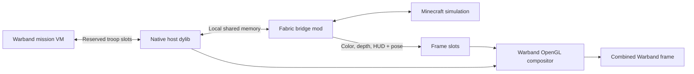

# Architecture

Warband is the host. Minecraft runs its normal server/client simulation alongside it. This adapter targets the native macOS Steam application, not a Windows runtime or WSE2.

## Mission operations

`source/install_module.py` copies installed Native into a separate module. A dedicated, unused mailbox troop is appended. Initialization, per-frame and incoming-hit triggers are appended to all 50 Native mission templates. Existing Native mission operations remain present.

The troop reserves 65,536 slots. Native host code locates a versioned signature in its own process and validates the slot buffer's writable region and allocation size. Mission operations own gameplay: camera setting, hidden avatar position, agent enumeration, damage delivery, army orders and scene collision rays. Native code publishes requests/results through the mailbox instead of hardcoding offsets into agent structures.

A five-frame TTL releases the camera/avatar after input expires. Shared-memory heartbeat checks reject stale Minecraft control. Epochs reject damage intended for agents from earlier missions. Up to 1,024 live agent proxies are published; each has an approximate box and current health.

## Coordinates and terrain

Warband engine coordinates use Z as up. The shared protocol uses Y as up; the native adapter swaps the axes. A per-scene mapping places Warband coordinates in a separate Minecraft region and flips the other horizontal axis to preserve orientation. Host units are treated as metres; mission operations exchange millimetre-scaled integers.

Minecraft requests scene collision rays. Warband's actual `cast_ray` operations return hits, in batches of up to 256 per frame. The Fabric server samples those hits into invisible terrain blocks for Minecraft movement. Those blocks are a collision approximation, not native terrain destruction or troop pathfinding.

## Rendering and input

Minecraft captures its world color/depth before the hand, then captures hand/HUD separately. Shared frame slots include the pose ID and projection parameters. A control pose is published only after that frame's pixels are available.

The host applies the pose in the next mission frame and acknowledges the corresponding ID. It composes only the matching slot. GLEW uniform hooks measure Warband's actual rendered camera and projection; composition checks position/direction/up/FOV against the captured pose. Host and Minecraft depth are linearized with their respective near/far planes before occlusion comparison.

Warband's drawable size drives Minecraft's internal render size. This avoids the tested Retina mismatch where a 2x Minecraft framebuffer could not fit the frame slots and appeared as a floating layer. Minecraft's transparent borderless window retains input while Warband draws its content. F8 and focus loss release control.

## Local files

| File | Purpose |
|---|---|
| `/tmp/warbandcraft/bridge.shm` | Versioned 8 MiB control/state/ray/entity/command transport |
| `/tmp/warbandcraft/frames.shm` | Three CPU frame slots; approximately 79 MiB |
| `/tmp/warbandcraft/core-<pid>-<generation>.dylib` | Unique hot-reload copy of the native core |
| `/tmp/warbandcraft/alignment.json` | Camera correspondence diagnostic |
| `/tmp/warbandcraft/camera-diagnostic.json` | Actual native camera measurement |

Layouts are defined in `source/native/protocol.h` and Java's `link/Protocol.java`. Legacy names such as `mhw` and `hunter` are inherited ABI identifiers; in this adapter they represent Warband and its player. Layout changes require updating both languages and the transport checks.

The loader can reload a changed native core between frames. Java mod changes require restarting Minecraft. The live game is not modified by repository packaging or builds.
